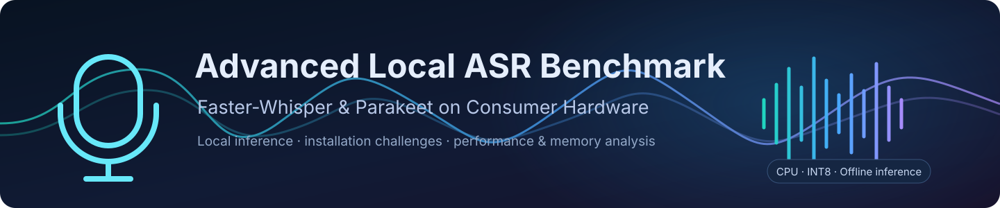
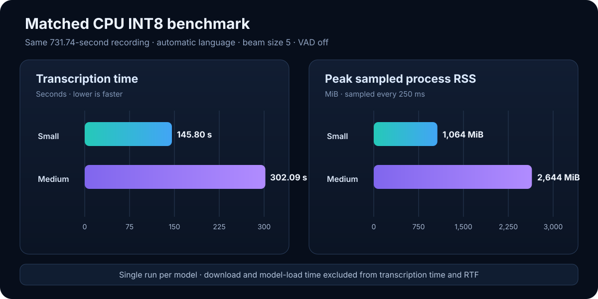
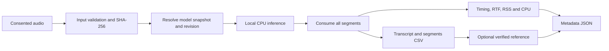
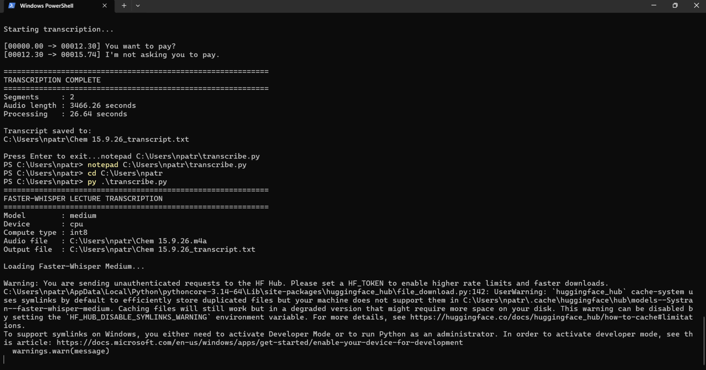
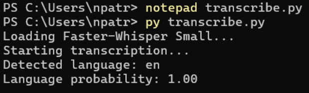
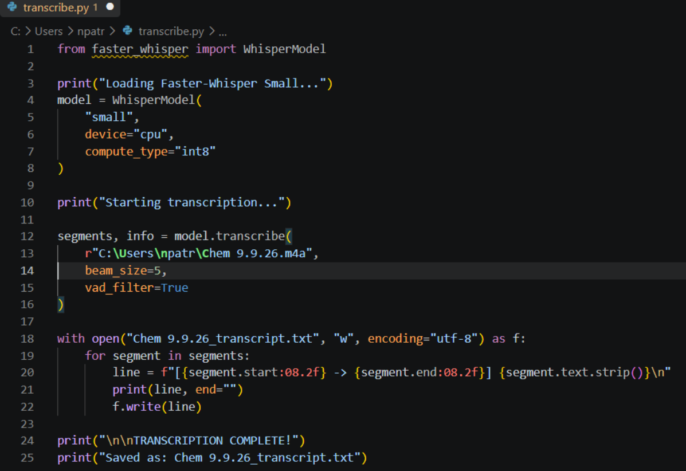
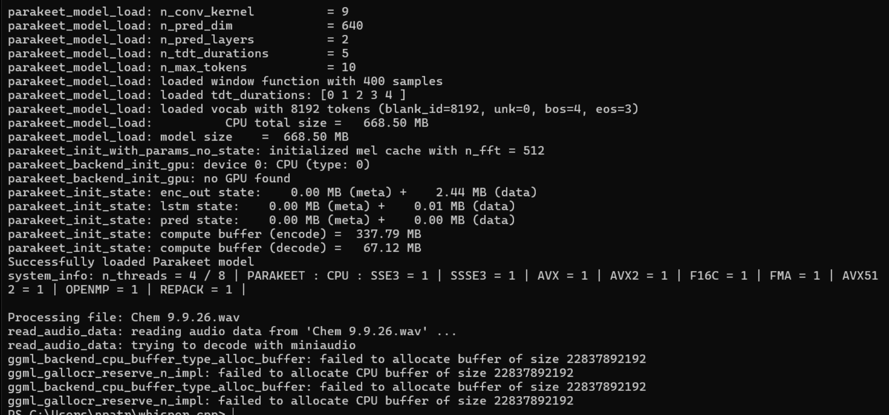
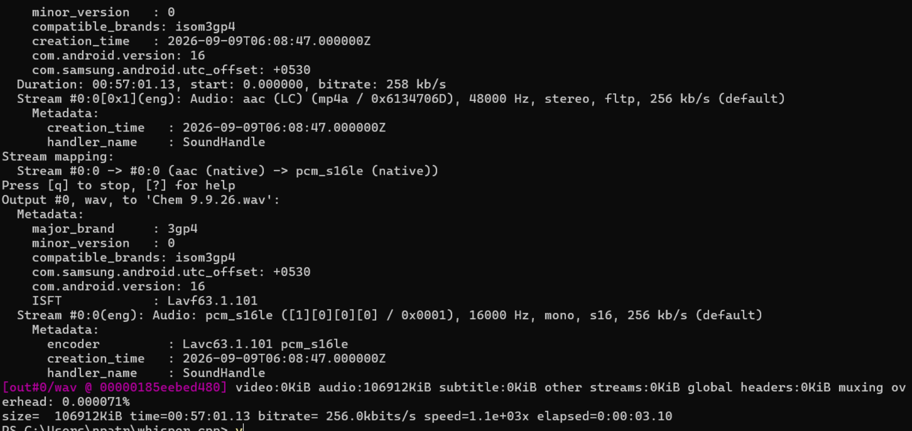
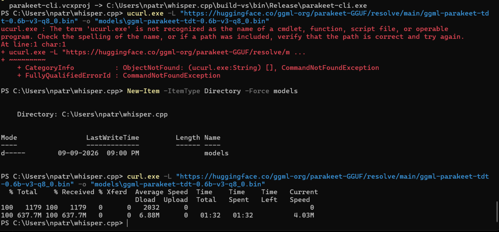

# Advanced Local ASR Benchmark

**Faster-Whisper and Parakeet on Windows consumer hardware**



    

> A standalone research project on deploying speech-recognition models locally, measuring inference time and memory, investigating VAD behavior, and documenting the practical engineering challenges encountered along the way.

## Project overview

Cloud speech APIs make transcription easy to access, but local inference introduces a different set of constraints: model downloads, native dependencies, CPU/RAM limits, long-form audio handling, and reproducible evaluation. This project explores those constraints on a Windows 11 consumer system.

The repository combines:
- A runnable **Faster-Whisper evaluation harness** for CPU inference.
- Matched **Small vs Medium** measurements on the same 12-minute recording.
- Exploratory **Parakeet/GGUF** experiments and a documented memory-allocation failure.
- A chronological installation and experiment log, reproducible setup scripts, automated tests, and selected evidence screenshots.

## Headline result: Faster-Whisper Small vs Medium

Both models processed the same **731.743-second (12 min 11.74 sec)** M4A recording. The original audio was not denoised, normalized, trimmed, or otherwise modified.



| Metric | Small | Medium |
|---|---:|---:|
| Transcription time | **145.798 s** | 302.089 s |
| Real-time factor (RTF) | **0.19925** | 0.41283 |
| Peak sampled process RSS | **1,064.01 MiB** | 2,644.46 MiB |
| Average sampled process CPU | 358.43% | 385.76% |
| Segments emitted | 63 | 147 |
| Detected language | English | English |
| Resolved model revision | `536b0662742c02347bc0e980a01041f333bce120` | `08e178d48790749d25932bbc082711ddcfdfbc4f` |

**Measured observation:** Small was approximately **2.07× faster** and used approximately **2.49× less peak sampled process memory** in these runs. Both completed faster than the recording's playback duration.

### Benchmark conditions

- Windows 11 x64, CPython 3.12.10 (64-bit), system RAM reported by the evaluator: approximately 23.96 GiB.
- CPU inference; requested compute type INT8 (runtime reported `int8_float32`). No CUDA/GPU inference was performed.
- Automatic language detection, beam size 5, VAD disabled, identical input audio, and a 900-second duration ceiling.
- Transcription timing includes consuming Faster-Whisper's lazy segment generator. Model download/cache and load times were measured separately.
- Process RSS and CPU were sampled every 250 ms; brief peaks can be missed.

**Accuracy limitation:** No human-verified reference transcript was supplied. WER/CER were not measured, so this project does not claim a formal accuracy winner. The user's positive assessment of Small and observations of lecture-specific wording in Medium are qualitative only. These are single-run measurements, not repeated-run medians.

## Research themes

### 1. Local inference and resource profiling

The evaluator records model repository and resolved commit, cache/download time, load time, transcription time, RTF, segment count, language detection, sampled process RSS/CPU, environment versions, input hashes, and optional WER/CER when a human-verified reference is supplied.

### 2. Installation and troubleshooting

| Challenge | Observed outcome |
|---|---|
| Python runtime discovery | Initial setup reported `No suitable Python runtime found`; the setup script was rewritten to enumerate installed 64-bit Python runtimes before selecting one. |
| CTranslate2 wheel download | pip repeatedly disconnected near 19 MB of a 20.4 MB wheel; retrying with `--resume-retries 15 --timeout 120` completed the installation. |
| Hugging Face Xet support | `hf_xet` was absent; regular HTTP fallback worked. |
| Windows symlinks | Symlink support was unavailable; Hugging Face used a less space-efficient cache fallback. |

### 3. Voice Activity Detection (VAD)

The default whole-file VAD run retained only about **3.84 seconds (0.52%)** of the 731.74-second recording. That was not a valid full-recording transcription benchmark. Separate timestamp diagnostics showed that retention varied substantially with processing-window size and threshold. The current default VAD configuration is not recommended for this recording until its behavior is checked against manually reviewed speech regions.

### 4. Parakeet exploration

An earlier Parakeet attempt reached an attempted CPU buffer allocation of approximately **22.8 GB** and failed on the tested system. A separate GGUF-based workflow was reported to work with chunking constraints, but the exact model artifact, revision, conversion and runtime were not preserved sufficiently for a reproducible rerun. Parakeet is therefore included as an exploratory finding, not as part of the current runnable package.

## Evaluation workflow



## Run the project

The verified package targets Windows x64 and Python 3.11 or 3.12. Model weights are downloaded from Hugging Face when first needed; they are not committed to the repository.

### 1. Clone and set up

```powershell
git clone https://github.com/nytro-gg/advanced-local-asr-benchmark.git
cd advanced-local-asr-benchmark
Set-ExecutionPolicy -Scope Process Bypass
.\scripts\setup.ps1
```

The setup script selects an installed 64-bit Python runtime, creates a project-local `.venv`, installs pinned dependencies, checks package consistency and native imports, and runs the tests.

### 2. Run a short first test

Place a consented 30–120 second audio clip in `audio/`, then run:

```powershell
.\scripts\run-small.ps1 -Audio .\audio\sample.wav
```

The helper enforces a 120-second first-run ceiling. For longer recordings, use the evaluator explicitly and choose an appropriate limit:

```powershell
.\.venv\Scripts\python.exe -m src.evaluate --audio .\audio\sample.wav --model medium --device cpu --compute-type int8 --max-audio-seconds 900
```

### 3. Optional WER/CER

Provide a manually checked, verbatim reference transcript with `--reference` (or `-Reference` in the PowerShell helper). Without a human-verified reference, the project does not report formal accuracy scores.

## Experimental evidence

These six screenshots document selected earlier setup and model experiments. They are historical supporting evidence—not terminal screenshots of the matched November Small/Medium runs, whose exact measurements are documented in the results files.

<p align="center">
  
  
  
</p>
<p align="center">
  
  
  
</p>

## Repository map

| Path | Purpose |
|---|---|
| `src/evaluate.py` | Faster-Whisper evaluation CLI and measurement pipeline |
| `scripts/setup.ps1` | Windows environment setup and dependency checks |
| `scripts/run-small.ps1` | Guarded first-run helper |
| `tests/test_evaluate.py` | Automated tests |
| `experiments/experiment-log.md` | Chronological lab notebook with setup failures, fixes, commands and findings |
| `results/results.md` | Detailed experimental results |
| `results/model-comparison.md` | Concise model and VAD comparison |
| `docs/benchmark-methodology.md` | Matched benchmark protocol and metric definitions |
| `docs/installation-and-troubleshooting.md` | Setup issues and resolutions |
| `docs/package-quickstart.md` | Reproducible package usage |
| `report/technical-report.md` | Consolidated technical report |
| `evidence/` | Selected experimental screenshots |

## Limitations and next steps

- Small and Medium are each represented by one measured run on one recording; repeated runs and medians are not available.
- There is no human-verified reference transcript, so WER/CER and a formal accuracy ranking are unavailable.
- The verified package is CPU-only; CUDA/GPU compatibility and GPU memory were not tested.
- VAD needs further diagnosis against manually reviewed speech regions.
- The exact earlier Parakeet artifact is not sufficiently documented for a reproducible rerun.
- Broader evaluation requires a consented, human-labelled dataset covering speakers, accents, noise, silence and long-form recordings.

## Detailed documentation

- [Benchmark methodology](docs/benchmark-methodology.md)
- [Installation and troubleshooting](docs/installation-and-troubleshooting.md)
- [Package quickstart](docs/package-quickstart.md)
- [Technical report](report/technical-report.md)
- [Experiment environment](report/experiment-environment.md)
- [Full results](results/results.md)
- [Model comparison](results/model-comparison.md)
- [Chronological experiment log](experiments/experiment-log.md)
- [Model notes](MODEL_NOTES.md)
- [Test protocol](TEST_PROTOCOL.md)
- [Verification report](VERIFICATION_REPORT.md)

---

**Maintainer:** [nytro-gg](https://github.com/nytro-gg)  
**Focus:** local ASR · reproducible experiments · Python · Windows · performance measurement
